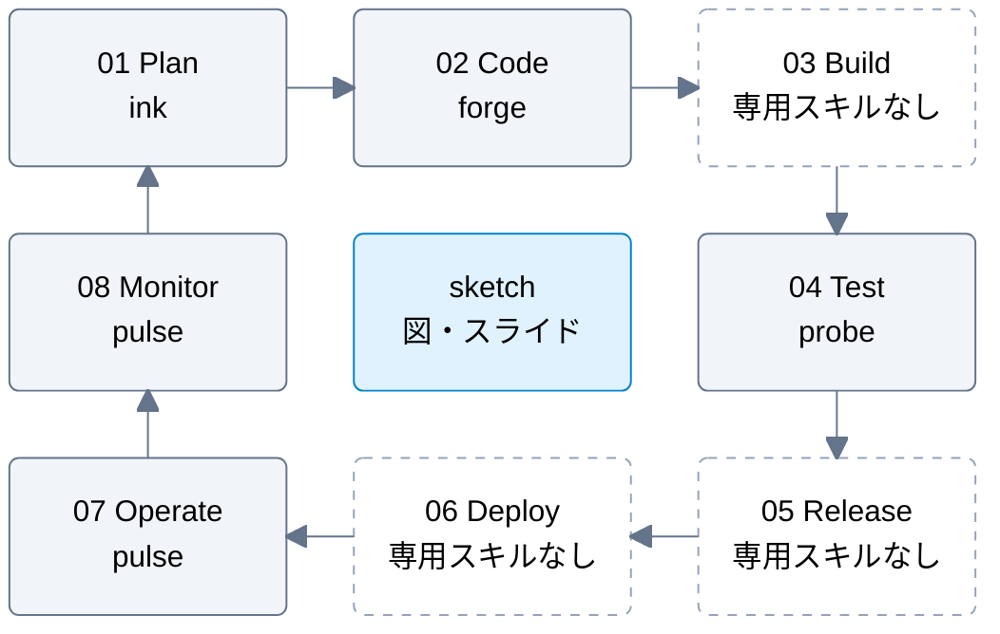

# DevOps サイクルとプラグインの担当範囲

要求・設計から変更のレビュー、運用での学習まで、判断の根拠と検証方法を残せる状態を目指す。
ここでは DevOps の流れを次の段階に分け、現在のスキルが支援する範囲を示す。

Plan から時計回りに進み、Monitor から次の計画へ運用の知見を戻す。破線の枠は専用スキルがない段階を示す。
[sketch](../plugins/sketch/README.md) は図全体を横断し、要求・構成・処理・結果を図やスライドで説明する。

## 段階ごとの役割

| 段階 | 担当 | 支援する判断・作業 |
| --- | --- | --- |
| Plan：要求・計画・設計 | [ink](../plugins/ink/README.md) | 誰の何を解決するかと受け入れ条件を整理し、要求の抜け・矛盾をレビューする。設計判断を記録し、具体的なシナリオで設計を検証する |
| Code：変更・レビュー | [forge](../plugins/forge/README.md) | 要求に沿って実装・検証し、コードを整理する。不具合・回帰をレビューする。変更を意味のあるコミットと PR にまとめる |
| Build：ビルド | 専用スキルなし | ビルド環境や CI パイプラインの構築・保守は未対応 |
| Test：テスト | [probe](../plugins/probe/README.md) | 変更に必要なテストを選び、ケースを設計・レビューする。テストの実装・実行はforgeのimplement-work-itemで扱う |
| Release：リリース | 専用スキルなし | リリース可否の判断、バージョン管理、成果物の公開は未対応 |
| Deploy：デプロイ | 専用スキルなし | 環境への展開、移行、通常のデプロイに伴う切り戻しは未対応 |
| Operate：運用 | [pulse](../plugins/pulse/README.md) | 障害の切り分け・影響軽減・復旧確認、振り返り、運用改善の優先付けと効果検証を支援する |
| Monitor：監視 | pulse | 利用者への影響から指標・通知条件・初動を設計する。常時監視は利用先の監視基盤が担う |

一件の要求を実装・検証・PRへ運ぶ手順は [工程の受け渡し](factory-workflow.md) を参照する。
ビルド基盤やデプロイ環境の構築・運用まで自動化するものではない。

## 運用から次の改善へ戻す

pulse の障害記録・ポストモーテム・運用指標を根拠に、ink で要求や設計を見直し、forge で変更を整え、probe で再発を検出するテストを設計する。
変更後は pulse で効果を確認し、監視や対応手順へ反映する。各スキルは単独でも使え、この順序での一括実行を必須にしない。

たとえば非同期処理の滞留なら、復旧記録から完了期限の要求を見直し、設計・コードの改善と滞留時のテストを整理する。
運用では受付の成功に加えて処理完了を監視し、同じ影響を早く捉えられるか確かめる。

## リポジトリ自身の CI・リリース

このリポジトリには [検証とプラグイン公開の自動化](plugin-maintenance.md) がある。
これは本リポジトリを保守する仕組みであり、利用先プロジェクト向けの Build・Release・Deploy スキルには含めない。
