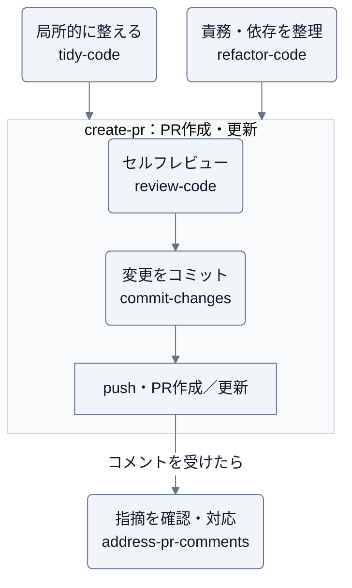

# forge

要求の実装・検証からコミット・PR・レビューまでを支援する、Claude Code / Codex 用プラグイン。

変更履歴は [GitHub Releases](https://github.com/Wataru-Toriumi/agent-skills/releases?q=forge) を参照する。

## スキル

| スキル | 用途 |
| --- | --- |
| [implement-work-item](skills/implement-work-item/SKILL.md) | 受け入れ条件に沿って実装・検証し、依頼範囲でPRまで進める |
| [refactor-code](skills/refactor-code/SKILL.md) | 振る舞いを保ち、責務・依存関係・重複を整理する |
| [tidy-code](skills/tidy-code/SKILL.md) | 今触る箇所を小さく整え、理解や次の変更を助ける |
| [commit-changes](skills/commit-changes/SKILL.md) | 差分を確認し、意味のある単位でコミットする |
| [create-pr](skills/create-pr/SKILL.md) | 変更と検証結果を整理し、GitHub PR を作成・更新する |
| [review-code](skills/review-code/SKILL.md) | 差分と関連コードを読み、根拠のある問題を指摘する |
| [address-pr-comments](skills/address-pr-comments/SKILL.md) | 受けた PR コメントを確認し、修正・検証・返信を進める |

コミットには Git、PR の操作には利用環境の GitHub 接続ツールまたは CLI と認証が必要。

## 想定実行順序

要求の実装には `implement-work-item` を使う。実装・検証後は、依頼の到達点に応じてコミット・PRへ進む。コード整理は必要な場合に選ぶ。`create-pr` はセルフレビューと必要なコミットを含むため、直接依頼できる。



レビューやコミットだけでも使える。指摘への対応で修正した場合も、検証・セルフレビューし、依頼範囲でコミット・pushする。

## 導入

利用するツールでマーケットプレイスを登録し、インストールする。

```sh
claude plugin marketplace add Wataru-Toriumi/agent-skills
claude plugin install forge@toripeeeeee-plugins
```

```sh
codex plugin marketplace add Wataru-Toriumi/agent-skills
codex plugin add forge@toripeeeeee-plugins
```

## 利用例

Claude Code では `/forge:<スキル名>`（例: `/forge:address-pr-comments`）で呼び出す。
Codex ではインストール後のスキル一覧から該当スキルを選ぶか、スキル名を指定して依頼する。

- 「implement-work-item で、このストーリーを実装・検証し、PRまで作成して」
- 「implement-work-item で、前回の作業記録から検証失敗の箇所を再開して」
- 「refactor-code で、請求計算と送信処理の責務を分けて。振る舞いは維持して」
- 「tidy-code で、この関数の条件分岐を、次の修正に備えて読みやすくして」
- 「commit-changes で、今回の修正を意味のある単位に分けてコミットして」
- 「create-pr で、このブランチから main 向けの PR を作成して」
- 「create-pr で、PR の説明文だけ下書きして」
- 「review-code で、この PR に回帰がないか確認して。結果はこの会話で教えて」
- 「address-pr-comments で、この PR の指摘を確認して修正し、push と返信まで進めて」
- 「address-pr-comments で、未対応のコメントを整理して。対応方針と返信案だけ出して」

コミットのみの依頼では push せず、PR 作成では必要なコミットと push を含めて進める。
`create-pr` は提出先の PR テンプレートに従う。
レビュー結果は会話で返し、GitHub への送信やコード修正は依頼に応じて行う。
PR コメントには、意図に応じて `[nits]`・`[imo]`・`[question]`・`[issue]` を付ける。使い分けは [コメントの接頭辞](skills/review-code/references/comment-prefixes.md) を参照する。
投稿を依頼された指摘は該当行・最小限の行範囲へ個別にコメントし、PR 全体に関わる内容だけを総評に書く。
`address-pr-comments` は指摘を現行コードと照合し、修正・返信・スレッド解決の状況を分けて報告する。
履歴の書き換えとマージは、明示的に依頼された場合に扱う。
