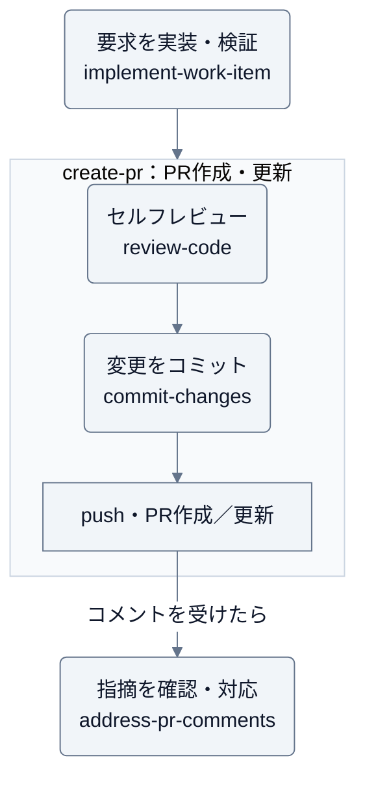

# forge

要求の実装・検証からコミット・PR・レビューまでを支援する、Claude Code / Codex 用プラグイン。

変更履歴は [GitHub Releases](https://github.com/Wataru-Toriumi/agent-skills/releases?q=forge) を参照する。

## スキル

| スキル | 用途 |
| --- | --- |
| [implement-work-item](skills/implement-work-item/SKILL.md) | 受け入れ条件に沿って実装・検証し、依頼の到達点まで進める。中断した作業の再開にも使う |
| [refactor-code](skills/refactor-code/SKILL.md) | 振る舞いを保ち、責務・依存関係・重複を整理する |
| [tidy-code](skills/tidy-code/SKILL.md) | 今触る箇所を小さく整え、理解や次の変更を助ける |
| [commit-changes](skills/commit-changes/SKILL.md) | 差分を確認し、意味のある単位でコミットする |
| [create-pr](skills/create-pr/SKILL.md) | 変更と検証結果を整理し、GitHub PR を作成・更新する |
| [review-code](skills/review-code/SKILL.md) | 差分と関連コードを読み、根拠のある問題を指摘する |
| [address-pr-comments](skills/address-pr-comments/SKILL.md) | 受けた PR コメントを確認し、修正・検証・返信を進める |

コミットには Git、PR の操作には利用環境の GitHub 接続ツールまたは CLI と認証が必要。

## 想定実行順序

実装からPR作成まで依頼した場合の流れ。
`implement-work-item` は依頼の到達点まで進行を管理し、`create-pr` はセルフレビュー・コミット・pushを含めてPRを作成する。



コード整理には必要に応じて `tidy-code`・`refactor-code` を使う。各スキルは単独でも使える。
同じ差分に対する検証・レビューは再利用し、修正した場合は影響する範囲を再確認する。

## 導入

利用するツールでマーケットプレイスを登録し、インストールする。

```sh
claude plugin marketplace add Wataru-Toriumi/agent-skills
claude plugin install forge@toripeeeeee-plugins
```

```sh
codex plugin marketplace add Wataru-Toriumi/agent-skills
codex plugin add forge@toripeeeeee-plugins
```

## 利用例

Claude Code では `/forge:<スキル名>`（例: `/forge:address-pr-comments`）で呼び出す。
Codex ではインストール後のスキル一覧から該当スキルを選ぶか、スキル名を指定して依頼する。

- 「implement-work-item で、このストーリーを実装・検証し、PRまで作成して」
- 「refactor-code で、請求計算と送信処理の責務を分けて。振る舞いは維持して」
- 「tidy-code で、この関数の条件分岐を、次の修正に備えて読みやすくして」
- 「commit-changes で、今回の修正を意味のある単位に分けてコミットして」
- 「create-pr で、このブランチから main 向けの PR を作成して」
- 「review-code で、この PR に回帰がないか確認して。結果はこの会話で教えて」
- 「address-pr-comments で、この PR の指摘を確認して修正し、push と返信まで進めて」

実装だけなら実装・検証まで、コミットだけならpushせずに止める。レビューや草案だけの依頼では、コードやGitHubを変更しない。
`create-pr` は提出先のPRテンプレートに従う。GitHubへの投稿・スレッド解決は依頼範囲で行い、履歴の書き換え・マージは明示的に依頼された場合に扱う。

投稿する指摘は該当箇所へ個別にコメントする。`[nits]` などの使い分けは [コメントの接頭辞](skills/review-code/references/comment-prefixes.md)、
受けた指摘への対応は [address-pr-comments](skills/address-pr-comments/SKILL.md) を参照する。
