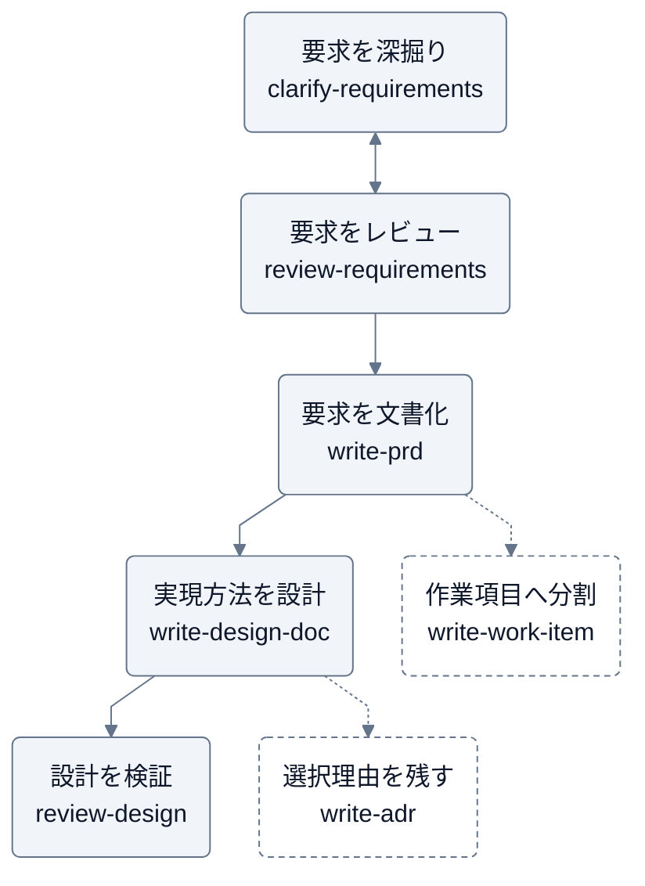

# ink

要求整理・文書作成と、要求・設計のレビューを支援する Claude Code / Codex 用プラグイン。

変更履歴は [GitHub Releases](https://github.com/Wataru-Toriumi/agent-skills/releases?q=ink) を参照する。

## スキル

| スキル | 答える問い | 既定の出力先 |
| --- | --- | --- |
| [clarify-requirements](skills/clarify-requirements/SKILL.md) | 要望の背景は何か、何が分かれば要求を決められるか | 会話 |
| [review-requirements](skills/review-requirements/SKILL.md) | 整理した要求に抜け・矛盾・曖昧さがないか、次に何を確認すべきか | 会話 |
| [write-prd](skills/write-prd/SKILL.md) | 誰の、どの課題を、どこまで解決するか | `docs/prd/<topic>.md` |
| [write-work-item](skills/write-work-item/SKILL.md) | イニシアチブ・エピック・ストーリーで何を目指し、どこまで届けるか | `docs/work-items/<type>/<topic>.md` |
| [write-design-doc](skills/write-design-doc/SKILL.md) | 要求をどう実現し、どう検証するか | `docs/design/<topic>.md` |
| [write-adr](skills/write-adr/SKILL.md) | なぜその設計判断を選び、何を受け入れたか | `docs/adr/<番号>-<topic>.md` |
| [review-design](skills/review-design/SKILL.md) | どの条件で設計が要求を満たし、どこで破綻するか | 会話 |

書式と保存先はユーザーの指定・リポジトリの慣例を優先する。チャット上の草案はファイルに保存しない。
文書作成スキルの `assets/` に Markdown のひな形を同梱している。

## 想定実行順序

要求整理から設計検証までの一例。点線は作業項目・判断記録への分岐を示す。必要なスキルから単独で使える。



要求レビューの指摘をもとに深掘りへ戻る。途中の会話メモにも、PRD化した後にも使える。
設計レビュー後も必要に応じて設計・作業項目を見直す。ADR は検討中にも作成でき、レビューの完了を採用の合意とは扱わない。

## 出力の基本構成

| 文書 | 基本構成 |
| --- | --- |
| 要求整理 | 目的と範囲・根拠を伴う要求・未決事項と次の確認 |
| 要求レビュー | 先に解消する点・未決でも進められる点・確認範囲 |
| ADR | 決定・背景と理由・受け入れる不利益 |
| Design Doc | 目的・提案する設計・検証計画 |
| PRD | 課題と目的・スコープ・要求と受け入れ条件 |
| イニシアチブ・エピック・ストーリー | 目的・範囲・成果や完了の確認方法・親子のつながり |
| 設計レビュー | 指摘・未確認事項・確認範囲と残るリスク |

各スキルの手順・フレームワーク・具体例は、上のスキル一覧から参照できる。
レビューの依頼だけで設計やコードを書き換えない。

## 導入

利用するツールでマーケットプレイスを登録し、インストールする。

```sh
claude plugin marketplace add Wataru-Toriumi/agent-skills
claude plugin install ink@toripeeeeee-plugins
```

```sh
codex plugin marketplace add Wataru-Toriumi/agent-skills
codex plugin add ink@toripeeeeee-plugins
```

## 任意の作図連携

図が必要な場合は、別途導入した `sketch` プラグインの `draw-mermaid` スキルと連携する。
未導入でも文書作成はできる。
`sketch` は同じマーケットプレイスから `claude plugin install sketch@toripeeeeee-plugins` または
`codex plugin add sketch@toripeeeeee-plugins` で個別に導入する。

## 利用例

Claude Code では `/ink:<スキル名>`（例: `/ink:write-work-item`）で呼び出す。
Codex ではインストール後のスキル一覧から該当スキルを選ぶか、スキル名を指定して依頼する。

- 「clarify-requirements で、申請の見落としを減らしたいという要望を、質問しながら深掘りして」
- 「clarify-requirements で、このヒアリングメモから要求と未決事項を整理して」
- 「review-requirements で、整理した要求をレビューして。追加で深掘りすべき点を示して」
- 「write-prd で、この分析メモから社内申請の PRD を作成して。対象は申請者と承認者」
- 「write-work-item で、この PRD をイニシアチブ・エピック・ストーリーに整理して」
- 「write-work-item で、このストーリーの説明と受け入れ条件を更新して。親エピックとの整合も確認して」
- 「write-design-doc で、この PRD と既存コードから通知機能を設計して。再送と重複通知も考慮して」
- 「review-design で、この注文 API の設計をレビューして。同時実行・再送・依存先の停止を確認して」
- 「write-adr で、このメモをもとに同期処理からキュー方式への変更判断を記録して」
- 「write-adr で、既存 ADR を置き換える提案を作成して。まだ採用は決まっていない」
