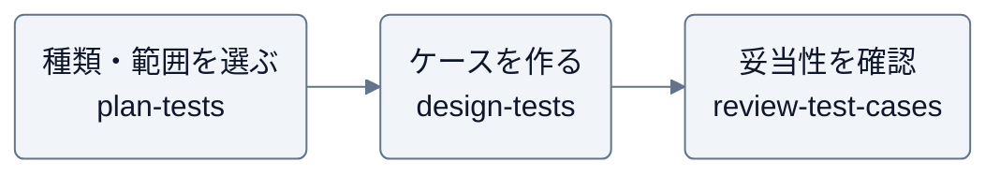

# probe

テスト設計・品質の検証を支援する、Claude Code / Codex 用プラグイン。

## スキル

| スキル | 用途 |
| --- | --- |
| [plan-tests](skills/plan-tests/SKILL.md) | 変更に必要なテストの種類・範囲・優先度を決める |
| [design-tests](skills/design-tests/SKILL.md) | 方針と要求を、前提・操作・期待結果を持つケースにする |
| [review-test-cases](skills/review-test-cases/SKILL.md) | 要求・差分と照合し、方針とケースの不足や誤りを指摘する |

## 想定実行順序

方針→ケース作成→レビューの順で使える。各スキルは単独でも使え、小さな変更では会話内の短い方針で進める。



指摘の内容に応じて、方針は `plan-tests`、ケースは `design-tests` で見直す。ケースのレビューはテスト実行やリリース承認を意味しない。

## 導入

利用するツールでマーケットプレイスを登録し、インストールする。

```sh
claude plugin marketplace add Wataru-Toriumi/agent-skills
claude plugin install probe@toripeeeeee-plugins
```

```sh
codex plugin marketplace add Wataru-Toriumi/agent-skills
codex plugin add probe@toripeeeeee-plugins
```

## 利用例

Claude Code では `/probe:<スキル名>`（例: `/probe:plan-tests`）で呼び出す。
Codex ではスキル一覧から選ぶか、スキル名を指定して依頼する。

- 「plan-tests で、今回の差分に必要なテストを整理して。選定理由と省く範囲も示して」
- 「design-tests で、この方針とストーリーからテストケースを作って」
- 「design-tests で、この組み合わせが成立するか整理して。除外するケースには根拠を付けて」
- 「review-test-cases で、このケースをレビューして。元の要求から方針の抜けも確認して」
