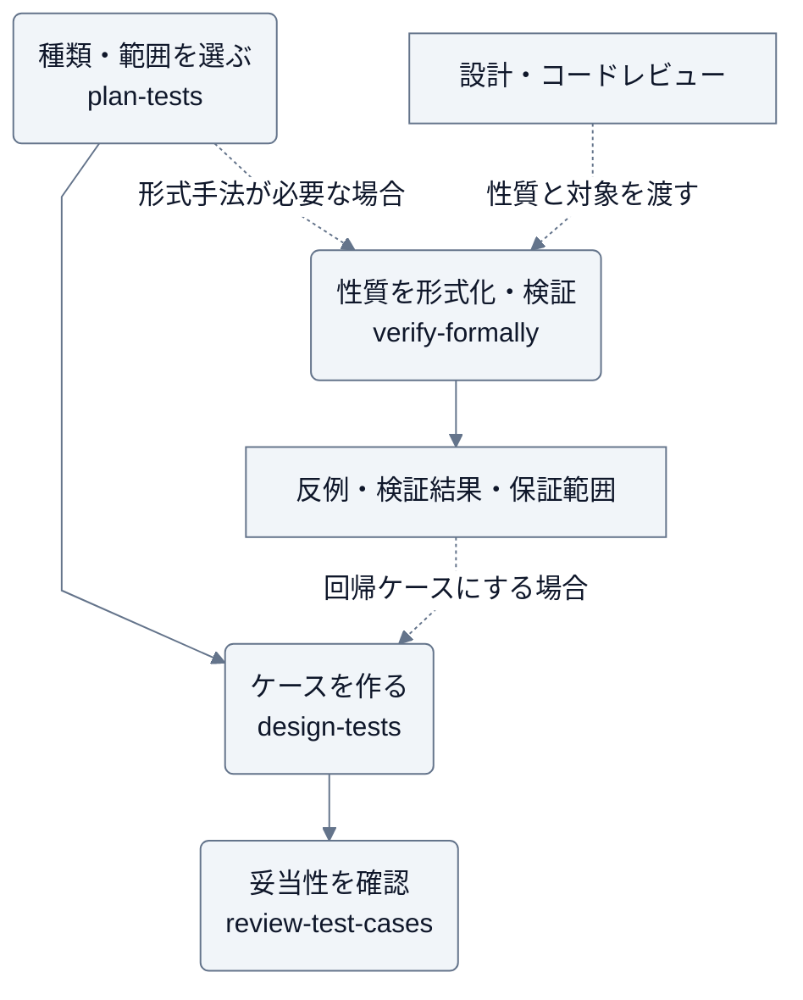

# probe

テスト設計・形式手法による検証を支援する、Claude Code / Codex 用プラグイン。

## スキル

| スキル | 用途 |
| --- | --- |
| [plan-tests](skills/plan-tests/SKILL.md) | 変更に必要なテストの種類・範囲・優先度を決める |
| [design-tests](skills/design-tests/SKILL.md) | 方針と要求を、前提・操作・期待結果を持つケースにする |
| [review-test-cases](skills/review-test-cases/SKILL.md) | 要求・差分と照合し、方針とケースの不足や誤りを指摘する |
| [verify-formally](skills/verify-formally/SKILL.md) | 性質を形式化して手法を選び、検証結果・反例・保証範囲を示す |

## 想定実行順序

方針→ケース作成→レビューの順で使える。各スキルは単独でも使え、小さな変更では会話内の短い方針で進める。
形式手法が必要な性質は `verify-formally` で検証する。設計・コードレビューから直接使うこともできる。



指摘の内容に応じて、方針は `plan-tests`、ケースは `design-tests` で見直す。ケースのレビューはテスト実行やリリース承認を意味しない。

## 導入

利用するツールでマーケットプレイスを登録し、インストールする。

```sh
claude plugin marketplace add Wataru-Toriumi/agent-skills
claude plugin install probe@toripeeeeee-plugins
```

```sh
codex plugin marketplace add Wataru-Toriumi/agent-skills
codex plugin add probe@toripeeeeee-plugins
```

## 利用例

Claude Code では `/probe:<スキル名>`（例: `/probe:plan-tests`）で呼び出す。
Codex ではスキル一覧から選ぶか、スキル名を指定して依頼する。

- 「plan-tests で、今回の差分に必要なテストを整理して。選定理由と省く範囲も示して」
- 「design-tests で、この方針とストーリーからテストケースを作って」
- 「design-tests で、この組み合わせが成立するか整理して。除外するケースには根拠を付けて」
- 「review-test-cases で、このケースをレビューして。元の要求から方針の抜けも確認して」
- 「verify-formally で、同時に予約しても一つの枠を二重確保しないか検証して。反例と探索範囲を示して」
- 「verify-formally で、この権限の関係を検証する手法と必要なモデルを選んで。今回は実行計画まで」

## 形式手法による検証

モデル検査、関係モデル検査、自動プログラム検証、定理証明、SMT/SAT、抽象解釈、有界モデル検査から、対象と必要な保証に合う方法を選ぶ。
詳しい適用場面は [手法の選び方](skills/verify-formally/references/method-selection.md) を参照する。

`ink` の設計レビュー、`forge` のコードレビューと併用する場合は `probe` も導入する。
検証ツールは同梱しない。利用可能なツールで実行し、環境がなければ選定・モデル案・実行に必要な条件を返す。
モデルの前提、探索範囲、未証明の部分を示し、未実行や反例がないことだけで検証完了としない。
