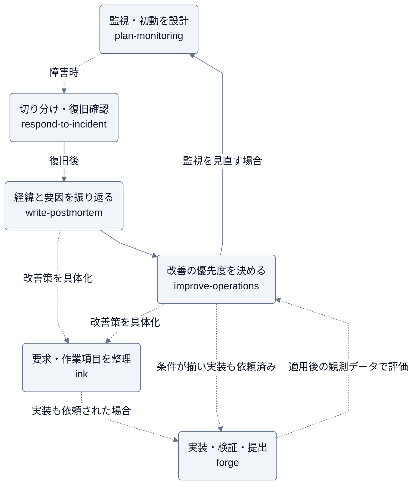
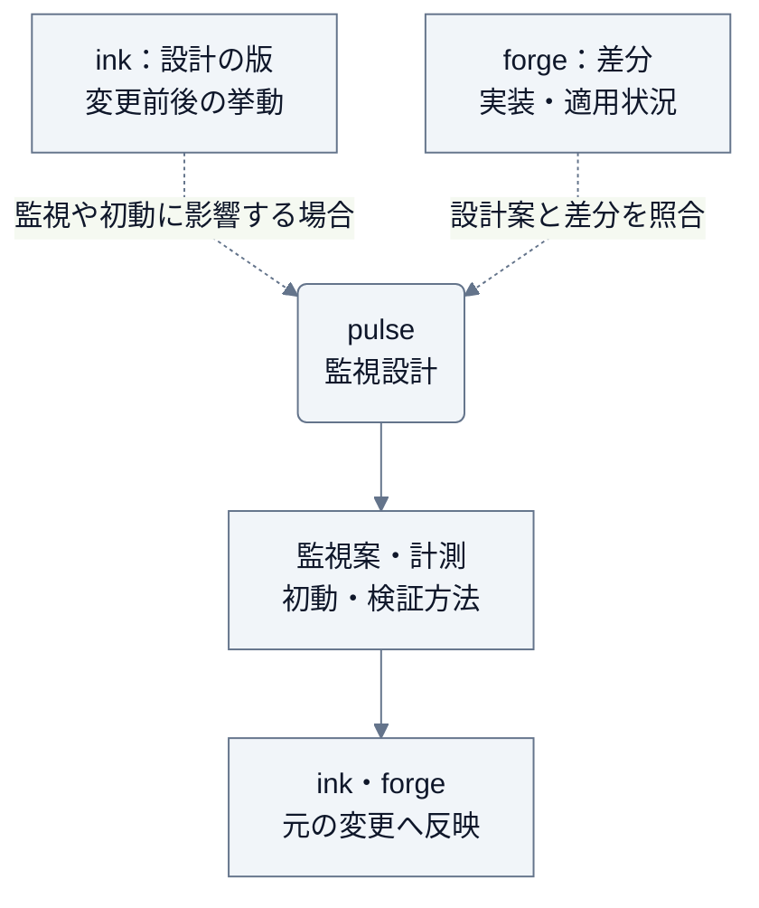

# pulse

監視設計・障害対応・振り返りを通じて、サービスの運用を改善する Claude Code / Codex 用プラグイン。

## スキル

| スキル | 用途 |
| --- | --- |
| [plan-monitoring](skills/plan-monitoring/SKILL.md) | 利用者への影響から、監視指標・通知条件・初動を設計する |
| [respond-to-incident](skills/respond-to-incident/SKILL.md) | 発生中の障害を切り分け、影響の軽減と復旧確認を進める |
| [write-postmortem](skills/write-postmortem/SKILL.md) | 障害の経緯と寄与要因から、再発・影響を減らす対策をまとめる |
| [improve-operations](skills/improve-operations/SKILL.md) | 運用負荷や障害の傾向から、改善の優先度と効果の測り方を決める |

## 想定実行順序

障害時は `respond-to-incident`、定期的な見直しは、日常の運用記録をもとに `improve-operations` から始められる。



改善結果は監視や対応手順へ反映する。監視設計だけの依頼から本番設定の適用や常時監視へは進まない。

## 改善策を実装へつなぐ

振り返りや改善計画を次の作業へ進めたい場合は、利用可能な ink・forge と連携する。
要求が曖昧なら ink の `clarify-requirements`、作業単位や受け入れ条件を整えるなら `write-work-item`、
実装する条件が揃っていれば forge の `implement-work-item` を使う。

問題の根拠、対策の採否、受け入れ条件、効果の測定方法を引き継ぐ。実装と運用への適用、効果の確認は分けて扱う。
計画だけの依頼では作業候補を返し、実装・PRまで依頼されていれば、その範囲で続ける。連携先が未導入でも必要な情報を整理して進められる。

## 設計・実装変更を監視へ反映する

ink・forge から変更前後の利用経路、対象の版と環境、既存の指標・通知・初動を受け取り、`plan-monitoring` で見直す。
不足する計測や未合意の閾値を明示し、監視案と必要な作業を呼び出し元へ返す。運用改善の効果評価は `improve-operations` で扱う。



監視案ができたことと、設定の作成・適用・通知検証が済んだことは別に記録する。
新旧版の共存中は各経路を確認し、新しい監視ができただけで旧監視を撤去しない。

## 導入

利用するツールでマーケットプレイスを登録し、インストールする。

```sh
claude plugin marketplace add Wataru-Toriumi/agent-skills
claude plugin install pulse@toripeeeeee-plugins
```

```sh
codex plugin marketplace add Wataru-Toriumi/agent-skills
codex plugin add pulse@toripeeeeee-plugins
```

## 利用例

Claude Code では `/pulse:<スキル名>`（例: `/pulse:plan-monitoring`）で呼び出す。
Codex ではスキル一覧から選ぶか、スキル名を指定して依頼する。

- 「improve-operations で、今月の障害・通知・手作業から改善案に優先度を付けて」
- 「plan-monitoring で、このサービスの監視と通知条件を整理して」
- 「respond-to-incident で、このアラートとログから影響範囲と次の確認を整理して」
- 「write-postmortem で、この対応記録から振り返りを書いて」
- 「この障害の再発防止策を、ink で受け入れ条件のある作業項目にして。今回は草案まで」
- 「この改善策を forge で実装・検証してPRまで。運用への適用後に効果を確かめる条件も残して」
