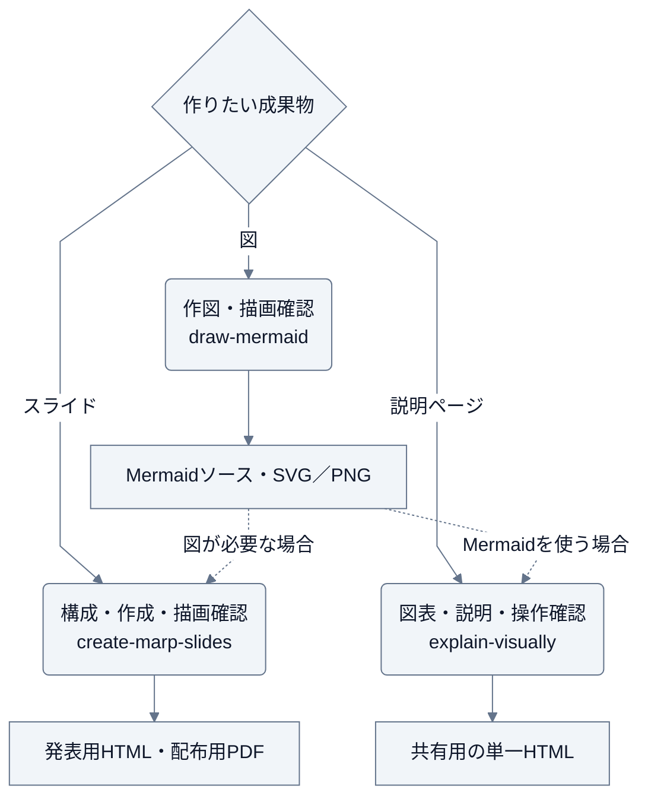

# sketch

図・スライド・HTMLの説明ページで伝える、Claude Code / Codex 用プラグイン。

変更履歴は [GitHub Releases](https://github.com/Wataru-Toriumi/agent-skills/releases?q=sketch) を参照する。

| スキル | 用途 |
| --- | --- |
| [draw-mermaid](skills/draw-mermaid/SKILL.md) | Mermaid の図種を選び、作図・描画確認する |
| [create-marp-slides](skills/create-marp-slides/SKILL.md) | Marp の構成・デザインを整え、全ページを描画確認する |
| [explain-visually](skills/explain-visually/SKILL.md) | 図表と短い説明を組み合わせ、単一HTMLで共有する |

## 想定実行順序

成果物に合うスキルから始める。スライドやHTMLにMermaidの図が必要なら、描画した図を組み込む。



図のソースのみ、PDFのみなど、指定があれば出力形式を合わせる。

## 使い方

利用するツールでマーケットプレイスを登録し、インストールする。

```sh
claude plugin marketplace add Wataru-Toriumi/agent-skills
claude plugin install sketch@toripeeeeee-plugins
```

```sh
codex plugin marketplace add Wataru-Toriumi/agent-skills
codex plugin add sketch@toripeeeeee-plugins
```

Claude Code では `/sketch:<スキル名>`、Codex ではスキル一覧やスキル名から利用する。

## Mermaid の図

- 「draw-mermaid で、この設計のシステム境界と依存関係を図にして」
- 「このシーケンス図に仕様にある権限エラーを追加して、読みやすく整理して」
- 「README の Mermaid が横長なので、意味を保って描き直して。描画結果も確認して」
- 「要求と検証の対応を要求図にして」
- 「試行計画をガントチャートにして、作業の依存を示して」
- 「予約する利用者のジャーニーと、役割ごとのユースケースを図にして」
- 「C4 の Context と Container で、システムの境界と内部構成を整理して」
- 「このブランチのマージと cherry-pick を Git graph で説明して」

図種は [用途別の選び方](skills/draw-mermaid/references/diagram-types.md)を参照する。構成図や循環図などには、配色・余白の設定を含む作図例を用意している。

Markdown の Mermaid ブロックや `.mmd` ソースを出力し、必要に応じて SVG / PNG を生成する。
描画には利用先のプレビューまたは Mermaid CLI などを使う。CLI・ブラウザー・MCP サーバーは同梱せず、自動導入しない。
描画できない環境でもソースは作成し、未検証の範囲を伝える。

### 配色

標準は通常・既存をグレー、変更・提案を青、未決・要確認をアンバーで表す。
ユーザー指定と利用先の既存配色を優先し、必要な箇所だけ強調する。
明暗別のテーマ設定を同梱している。

- 「提案は紫、未決事項はアンバーにして」
- 「暗い背景向けの PNG にして」

色値・適用例・明暗テーマの注意点は [配色ルール](skills/draw-mermaid/references/colors.md) を参照する。

### 動的な図

動的表現は [アニメーション・クリック操作・再描画の使い分け](skills/draw-mermaid/references/dynamic.md) に従う。
掲載先の対応を確認し、動きやクリックがなくても読める図にする。

- 「通信の方向を動く矢印で強調して。README 向けの静止版も用意して」
- 「この図のノードから関連資料を開けるようにして」

## Marp のスライド

- 「create-marp-slides で、この提案を10分の発表にして。Markdown と PDF が欲しい」
- 「この Marp を、内容を保って読みやすくして。全ページの描画も確認して」

日本語向けの [テーマ](skills/create-marp-slides/assets/theme.css) と [ひな形](skills/create-marp-slides/assets/deck-template.md) を同梱する。
構成と見た目を整え、編集用ソースと、発表用のフェード付き HTML・配布用の静止 PDF を出力する。形式の指定があればそちらを優先する。
HTML は図やアイコンを埋め込んだ1ファイルとして共有できる。ダウンロードして対応ブラウザーで開くと、オフラインでもページ操作やアニメーションが動く。
書き出しには利用環境の Marp を使い、PDF・画像などには対応ブラウザーも必要。
標準の PPTX は画像ベースになる。環境と出力形式の詳細は [描画と出力](skills/create-marp-slides/references/rendering.md) を参照する。

## HTMLの説明ページ

- 「explain-visually で、この処理の流れを段階ごとに確認できるHTMLにして」
- 「この二つの設計案の違いと制約を、図と比較表で説明して」

[ひな形](skills/explain-visually/assets/explanation.html) をもとに、図表・説明・出典を一つのページにまとめる。
HTMLだけをダウンロードしてブラウザーで開けるようにし、オフライン・狭い画面・キーボード操作・印刷時の表示を確認する。
レビュー結果を受け取る場合は、指摘と根拠を保って説明する。表示を整えることと、要求や設計の妥当性を判断することは分ける。

## 他のプラグインから利用する

`ink` などと併用する場合も `sketch` を個別に導入する。
利用側のスキルから、利用可能なスキルに目的・内容・出力先を渡す。
