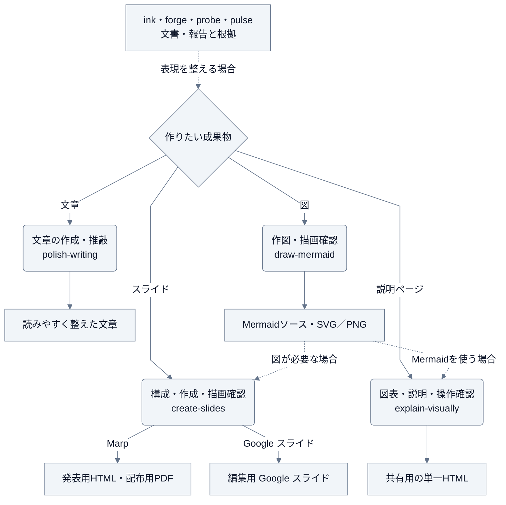

# sketch

文章・図・スライド・HTMLの説明ページで伝える、Claude Code / Codex 用プラグイン。

変更履歴は [GitHub Releases](https://github.com/Wataru-Toriumi/agent-skills/releases?q=sketch) を参照する。

| スキル | 用途 |
| --- | --- |
| [polish-writing](skills/polish-writing/SKILL.md) | 日本語の意味と根拠を保ち、読みやすく簡潔に作成・推敲する |
| [draw-mermaid](skills/draw-mermaid/SKILL.md) | Mermaid の図種を選び、作図・描画確認する |
| [create-slides](skills/create-slides/SKILL.md) | Marp・Google スライドで資料を作成・編集し、全ページの表示を確認する |
| [explain-visually](skills/explain-visually/SKILL.md) | 図表と短い説明を組み合わせ、単一HTMLで共有する |

## 想定実行順序

成果物に合うスキルから始める。スライドやHTMLにMermaidの図が必要なら、描画した図を組み込む。
文章には `polish-writing` を使う。図・スライド・説明ページの文面を整える場合も、必要事項や指定書式を保って推敲する。



旧 `create-marp-slides` の呼び出しは `create-slides` に変更する。Marp と Google スライドのどちらもこのスキルを使う。
図のソースのみ、PDFのみなど、指定があれば出力形式を合わせる。形式が未指定で判断できない場合は、編集・共有する場所を確認する。

## 使い方

利用するツールでマーケットプレイスを登録し、インストールする。

```sh
claude plugin marketplace add Wataru-Toriumi/agent-skills
claude plugin install sketch@toripeeeeee-plugins
```

```sh
codex plugin marketplace add Wataru-Toriumi/agent-skills
codex plugin add sketch@toripeeeeee-plugins
```

Claude Code では `/sketch:<スキル名>`、Codex ではスキル一覧やスキル名から利用する。

## 日本語の文章

- 「polish-writing で、この説明を利用者向けに短く読みやすくして。条件と例外は残して」
- 「polish-writing で、このメモからメンテナンス案内の草案を書いて。日時や影響範囲はメモにある情報を使って」

文章の作成・推敲に単独で使える。要求や設計の内容を決めるときは `ink` などの専用スキルと併用する。
出力先と書式は依頼に合わせ、チャット上の草案はファイルに保存しない。
既存の文章検査がある環境では、意味の確認とあわせて検査する。専用ツールの導入は不要。

## Mermaid の図

- 「draw-mermaid で、この設計のシステム境界と依存関係を図にして」
- 「このシーケンス図に仕様にある権限エラーを追加して、読みやすく整理して」
- 「README の Mermaid が横長なので、意味を保って描き直して。描画結果も確認して」
- 「要求と検証の対応を要求図にして」
- 「試行計画をガントチャートにして、作業の依存を示して」
- 「予約する利用者のジャーニーと、役割ごとのユースケースを図にして」
- 「C4 の Context と Container で、システムの境界と内部構成を整理して」
- 「このブランチのマージと cherry-pick を Git graph で説明して」

図種は [用途別の選び方](skills/draw-mermaid/references/diagram-types.md)を参照する。構成図や循環図などには、配色・余白の設定を含む作図例を用意している。

Markdown の Mermaid ブロックや `.mmd` ソースを出力し、必要に応じて SVG / PNG を生成する。
描画には利用先のプレビューまたは Mermaid CLI などを使う。CLI・ブラウザー・MCP サーバーは同梱せず、自動導入しない。
描画できない環境でもソースは作成し、未検証の範囲を伝える。

### 配色

標準は通常・既存をグレー、変更・提案を青、未決・要確認をアンバーで表す。
ユーザー指定と利用先の既存配色を優先し、必要な箇所だけ強調する。
明暗別のテーマ設定を同梱している。

- 「提案は紫、未決事項はアンバーにして」
- 「暗い背景向けの PNG にして」

色値・適用例・明暗テーマの注意点は [配色ルール](skills/draw-mermaid/references/colors.md) を参照する。

### 動的な図

動的表現は [アニメーション・クリック操作・再描画の使い分け](skills/draw-mermaid/references/dynamic.md) に従う。
掲載先の対応を確認し、動きやクリックがなくても読める図にする。

- 「通信の方向を動く矢印で強調して。README 向けの静止版も用意して」
- 「この図のノードから関連資料を開けるようにして」

## 工程を動きで説明するスライド

「create-slides で、通知タスクが失敗し、待機して再試行する流れを見せて。発表中は矢印キーで1工程ずつ送りたい」

タスクの印を残したまま、位置と処理状態を更新する。工程ごとにページを分け、移動の途中でも通常のキーで進み、戻れるようにする。[移動・合流・再試行の作り方](skills/create-slides/references/flow-animation.md)

## Marp のスライド

- 「create-slides で、この提案を10分の発表にして。Markdown と PDF が欲しい」
- 「この Marp を、内容を保って読みやすくして。全ページの描画も確認して」

日本語向けの [テーマ](skills/create-slides/assets/theme.css) と [ひな形](skills/create-slides/assets/deck-template.md) を同梱する。
構成と見た目を整え、編集用ソースと、発表用のフェード付き HTML・配布用の静止 PDF を出力する。形式の指定があればそちらを優先する。
HTML は図やアイコンを埋め込んだ1ファイルとして共有できる。ダウンロードして対応ブラウザーで開くと、オフラインでもページ操作やアニメーションが動く。
書き出しには利用環境の Marp を使い、PDF・画像などには対応ブラウザーも必要。
標準の PPTX は画像ベースになる。環境と出力形式の詳細は [描画と出力](skills/create-slides/references/rendering.md) を参照する。

## Google スライド

標準の納品物は編集用 Google スライド。配布用 PDF も欲しい場合は「PDF も付けて」と指定する。

- 「create-slides で、この設計案を10分で説明する資料にして。Google スライドで編集したい」
- 「この Google スライドをテンプレートに別資料を作って。原本は残して」
- 「この Google スライドの比較表を更新して、文字の欠けも確認して」
- 「手元の `demo.mp4` を Google スライドの3枚目に入れて。発表モードで動画の再生を確認して」

新規作成・テンプレートからの作成・既存資料の編集に対応する。本文・表・図形を編集できる形で作り、保存後の内容と全ページの表示を確認する。
Google スライドに接続できるコネクター・API・ブラウザー操作などが必要。接続や認証は同梱せず、利用環境で使える手段を選ぶ。
接続できない場合も構成や本文案を作り、Google スライドへの反映が未完了であることを伝える。共有設定の変更や通知は依頼に合わせる。

## HTMLの説明ページ

- 「explain-visually で、この処理の流れを段階ごとに確認できるHTMLにして」
- 「この二つの設計案の違いと制約を、図と比較表で説明して」

[ひな形](skills/explain-visually/assets/explanation.html) をもとに、図表・説明・出典を一つのページにまとめる。
HTMLだけをダウンロードしてブラウザーで開けるようにし、オフライン・狭い画面・キーボード操作・印刷時の表示を確認する。
レビュー結果を受け取る場合は、指摘と根拠を保って説明する。表示を整えることと、要求や設計の妥当性を判断することは分ける。

## 他のプラグインから利用する

`ink`・`forge`・`probe`・`pulse` と併用する場合は `sketch` も導入する。
文章の推敲や図解が必要なときに使い、Marp・Google スライドの発表資料、HTML の説明ページは依頼に合わせて作成する。

| 呼び出し元 | 利用例 | 保持する情報 |
| --- | --- | --- |
| ink | PRD・設計書・ADR の推敲、要求や設計の図解 | 受け入れ条件、判断の理由、未決事項 |
| forge | PR 本文・レビュー結果・返信案の整理 | 対象の差分、指摘の根拠、検証と反映の状況 |
| probe | テスト方針・ケースの整理、反例の図解 | 前提・期待結果、探索範囲、未実行・未完了 |
| pulse | 障害報告・改善案の推敲、経緯の図解 | 時刻、観測事実と仮説、復旧と原因解消の区別 |

呼び出し元から読者・目的・本文や根拠・変更範囲・出力先を渡し、仕上げた成果物を元の内容と照合する。
内容の判断は呼び出し元が担当する。障害対応中は復旧と状況共有を優先し、推敲や描画を待たせない。
短い説明で足りる場合や sketch が未導入の場合は、各プラグインだけで作業を続けられる。
