<!-- _class: lead cover -->
<!-- _paginate: false -->
<!-- _header: "" -->
<!-- _footer: "" -->

# レビューを小さく始める

**レイアウト例 — 架空の提案**

---

## 一つの差分に一つの目的を置く

目的の異なる変更が混ざると、確認する範囲が広がります。

- 構造の整理と機能追加を分ける
- 変更理由を短い説明で伝える
- それぞれの差分を検証できる状態にする

> 目的を揃えると、何を確認すべきかを共有できます。

<!-- このページは説明例。実際に確認した課題と根拠へ置き換える。 -->

---

## 分割は確認のしやすさで決める

| 観点 | まとめる | 分ける |
| --- | --- | --- |
| 変更の目的 | 同じ目的 | 別の目的 |
| 依存関係 | 分離すると動かない | 個別に検証できる |
| 取り消し | 一緒に戻す | 個別に戻せる |

> 行数を揃えるためだけに分割しません。

---

## まず一つの変更で試す

  <label class="flow-control"><input type="checkbox" checked> 動きを表示</label>
  
  

> 判断のしやすさを確認し、続ける範囲を決めます。

---

<!-- _class: summary message -->

## まとめ

次の変更で、小さく試す。

**決めたいこと：試行する変更と担当**

> 期待する効果と確認方法を共有してから始めます。

<!-- 実際の依頼に合わせ、担当・時期・判断事項を具体化する。 -->
