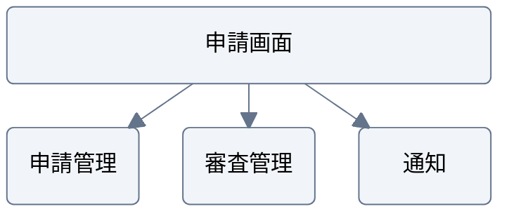

# 配置を揃えた構成

架空の申請システムの例。層や領域の配置を明示したい場合に使う。分岐や処理順序が主題なら flowchart にする。

この線は画面が利用する機能を表す。横並びを実行順序と解釈させない。
`columns` と占有列数で配置を調整し、長いラベルを縮小して枠へ詰め込まない。
同じ層の枠を揃え、`padding` で矢印とラベルの間隔を取る。

## 構文の確認先

[Block diagram の公式資料](https://mermaid.js.org/syntax/block.html)
