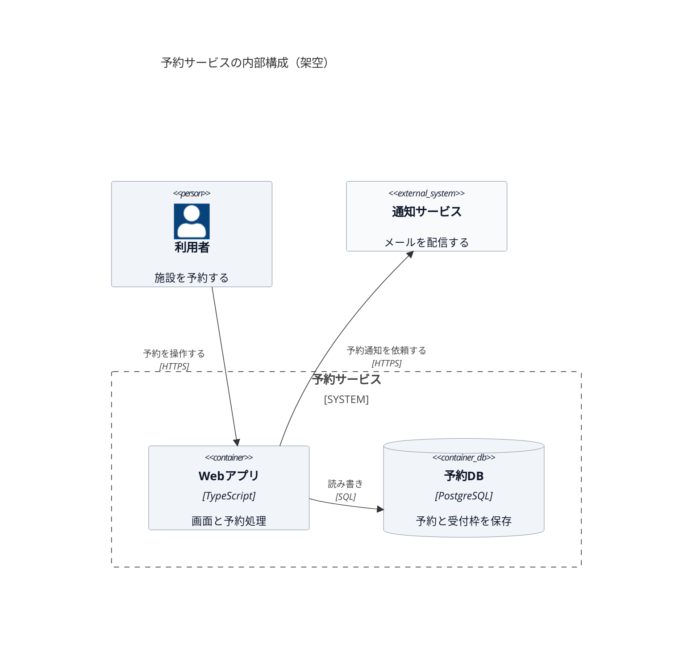

# C4：アプリとデータストア

[Context 図](c4-context.md)の予約サービスを展開した、架空の Container 図。
アプリ・データストアの責務、技術、通信を示す。ここでの Container は Docker コンテナとは限らない。

台数・配置先・フェイルオーバーは Deployment 図に分ける。図を埋めるために未決の技術や接続を補わない。
配置と掲載先への対応は [C4 の使い分け](../references/c4.md) を参照する。

## 確認先

- [C4 model：Container](https://c4model.com/diagrams/container)
- [Mermaid の C4 構文](https://mermaid.js.org/syntax/c4.html)
