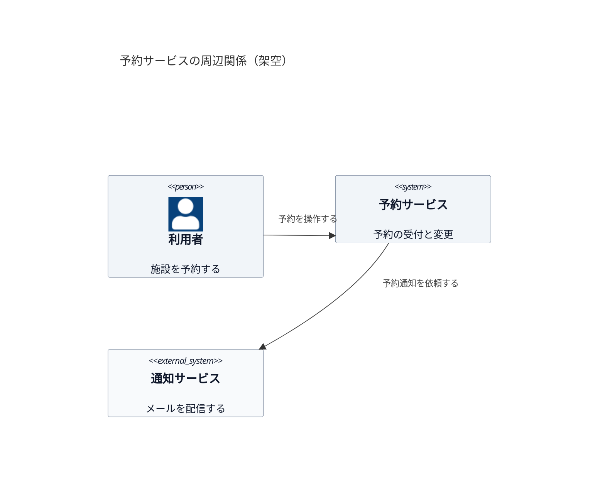

# C4：システムの周辺関係

架空の予約サービスの Context 図。利用者、対象システム、直接連携する外部システムを示す。
内部のアプリ・DB・通信方式は [Container 図](c4-container.md) で扱う。

外部は組織の外という意味ではなく、今回描くシステムの境界の外を指す。
C4 の粒度は [C4 の使い分け](../references/c4.md) を参照する。

## 確認先

- [C4 model：System context](https://c4model.com/diagrams/system-context)
- [Mermaid の C4 構文](https://mermaid.js.org/syntax/c4.html)
