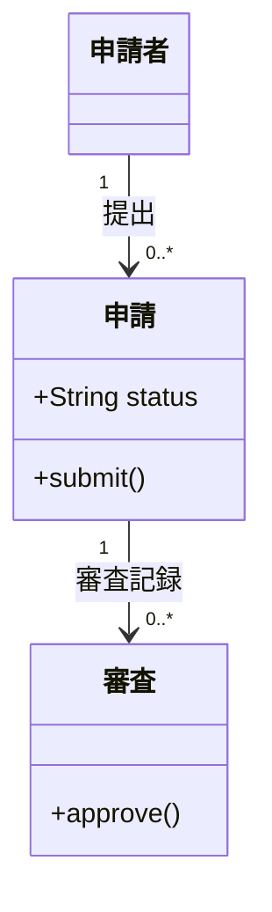

# 型の責務と関係

架空の申請モデルの例。型の属性・操作・関連を説明するときに使い、テーブルのキーや保存構造が主題なら ER 図にする。
関連を継承や合成に置き換えない。多重度や所有関係は設計で確認できるものだけを書く。

メソッドや属性は問いに必要なものへ絞る。実装クラスの全メンバーを列挙しない。

## 構文の確認先

[Class diagram の公式資料](https://mermaid.js.org/syntax/classDiagram.html)
