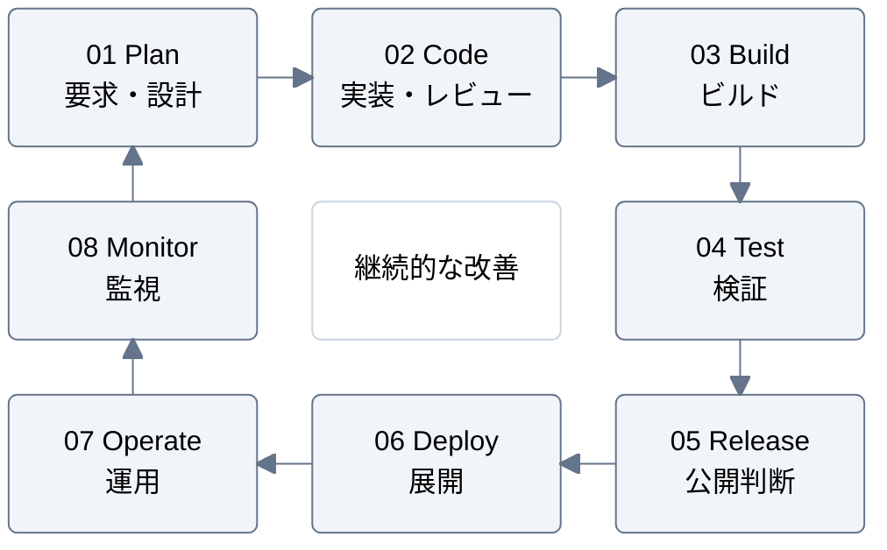

# 循環するプロセス

DevOps の8段階を時計回りに並べる例。周回する流れを示したいときに使う。
中央はサイクル全体の目的であり、独立した処理段階ではない。

番号と矢印で読み順を示し、Monitor から Plan へ学びを戻す。
実際の反復・並行作業は目的に応じて補い、工程の一括実行や承認手順を意味させない。
枠の大きさと間隔を揃え、ラベルは段階名と役割の2行に分ける。

## 構文の確認先

[Block diagram の公式資料](https://mermaid.js.org/syntax/block.html)
