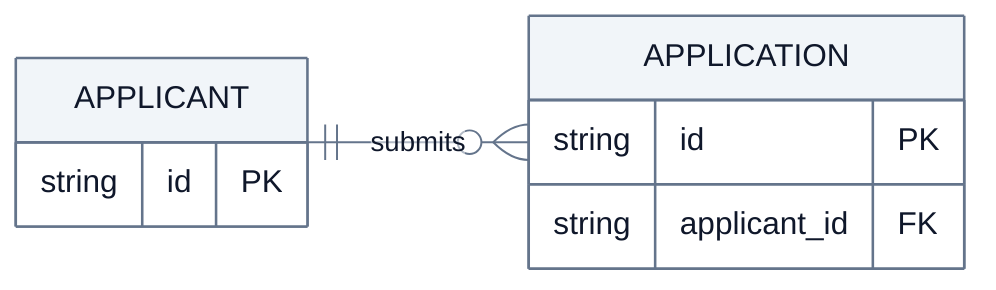

# データの関連

架空の申請機能の例。実際の図では入力資料にある要素・条件へ置き換える。

関連の両端で「最小数・最大数」を確かめる。コードや仕様で確認できない多重度は未決として本文へ残し、図で断定しない。
概念モデルなら属性は省いてよい。物理モデルならキーと参照先を揃え、見栄えのために制約を変更しない。

この例は「申請者は申請を0件以上持ち、各申請の申請者は必ず1人」という前提。
エンティティを横に並べ、関連名と多重度を読める間隔を取る。属性が多いときは図を用途別に分ける。

## 構文の確認先

対応バージョンで使える構文は [ER diagram の公式資料](https://mermaid.js.org/syntax/entityRelationshipDiagram.html) で確認する。
