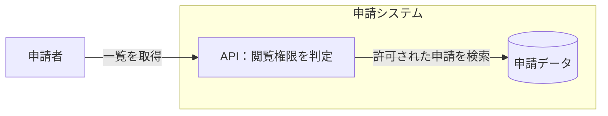

# 構成と処理の分岐

架空の申請機能の例。実際の図では入力資料にある要素・条件へ置き換える。

構成図では責務と境界、処理図では条件と結果に焦点を当てる。
識別子と表示ラベルを分け、日本語や記号を含む flowchart のラベルは引用符で囲む。
小文字の `end` はブロック終端と衝突するため、ノード ID やそのままのラベルに使わない。

これは依存関係の図であり、認証や失敗時の処理順序を網羅した図ではない。
構成を説明する線に全応答を追加して煩雑になる場合は、実行時の図を別にする。
`subgraph` 内の向きは外部との接続に影響されるため、方向指定だけで配置を固定できるとは考えない。

## 構文の確認先

対応バージョンで使える構文は [Flowchart の公式資料](https://mermaid.js.org/syntax/flowchart.html) で確認する。
