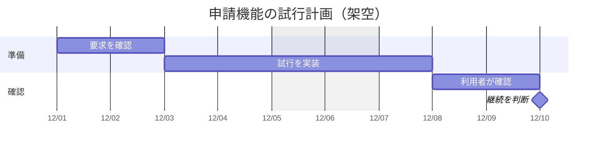

# 作業期間と依存

架空の試行計画の例。日付・期間・依存を示したい場合に使う。出来事を順に並べるだけなら timeline にする。
開始日、所要期間、休日の扱いを元の計画に合わせる。以下は土日を除外する例。

`after` は作業の依存を表す。担当者の稼働や並行作業が実現可能かは別に確認する。
予定の日付を実績と混ぜず、`done` などの状態も確認できたものだけ付ける。

## 構文の確認先

[Gantt の公式資料](https://mermaid.js.org/syntax/gantt.html)
