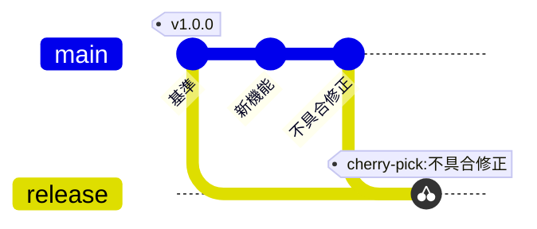

# Git：個別の修正を取り込む

架空の保守作業の例。main の修正だけを release へ取り込む。

release に新機能は取り込まれない。cherry-pick は変更の取り込みを表し、元コミットと同じ SHA になるわけではない。
実際の履歴を描く場合は、取り込み先のコミットも確認する。図の生成を理由に Git 履歴を変更しない。

## 構文の確認先

[GitGraph の公式資料](https://mermaid.js.org/syntax/gitgraph.html)
