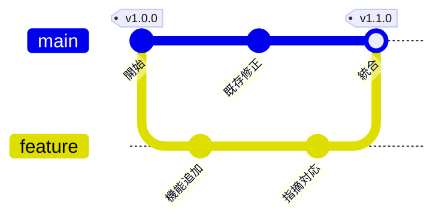

# Git の分岐と統合

架空の変更作業の例。並行する変更をマージコミットで統合し、公開タグを付ける。

実際の履歴を説明するときは Git のコミットと親子関係を確認する。マージ・rebase・squash を同じ履歴として描かない。
`merge` はマージコミットを描く。fast-forward や squash 後の履歴を説明するときは、存在しないマージ線を足さない。
色はブランチの区別に使い、良否を意味させない。個別修正の取り込みは [cherry-pick の例](gitgraph-cherry-pick.md) を参照する。
図の記法は説明用であり、Git コマンドを実行する手順や許可にはならない。

## 構文の確認先

[GitGraph の公式資料](https://mermaid.js.org/syntax/gitgraph.html)
