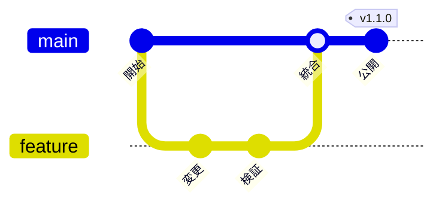

# Git の分岐と統合

架空の変更作業の例。ブランチがどこから分岐し、どこへ統合されるかを示す。

実際の履歴を説明するときは Git のコミットと親子関係を確認する。マージ・rebase・squash を同じ履歴として描かない。
図の記法は説明用であり、Git コマンドを実行する手順や許可にはならない。

## 構文の確認先

[GitGraph の公式資料](https://mermaid.js.org/syntax/gitgraph.html)
