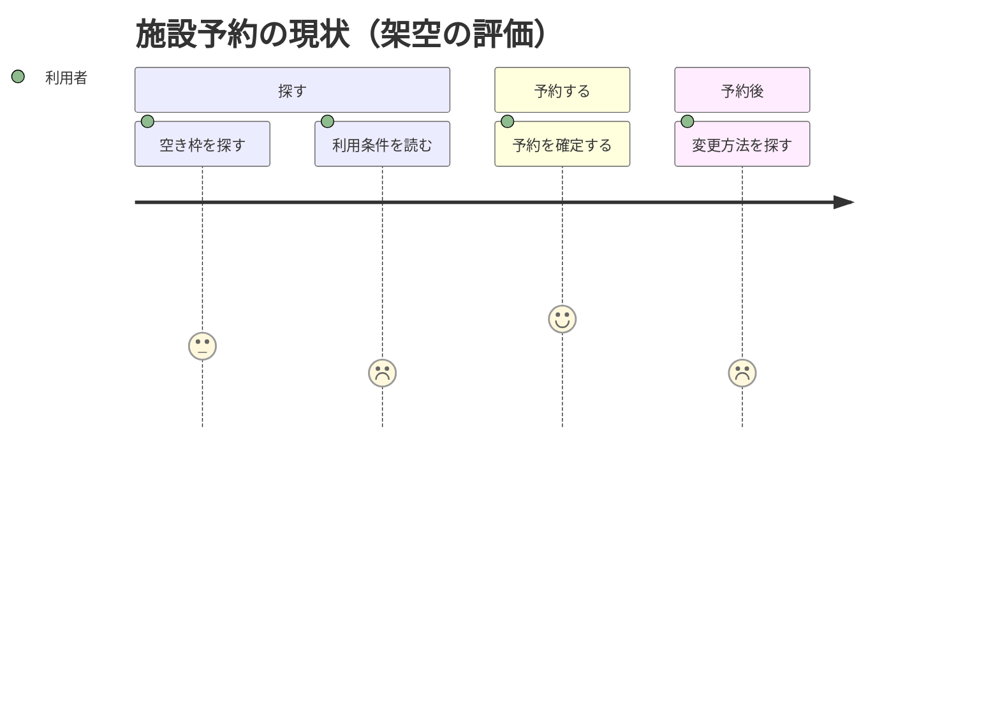

# 利用体験と困りごと

架空の施設予約の現状例。利用者の目的は「空き枠を予約し、必要なら変更する」。一人の利用者の行動を段階ごとに追い、困る箇所を示す。
評価は1〜5で、この例では1を悪い体験、5を良い体験とする。実際の評価は調査結果や明示された仮説から取り、現状と改善案を分ける。

この例では、利用条件が別ページに分散し、予約後に変更の入口を見つけにくいと仮定している。
接点・困りごと・評価根拠など、図に収まらない情報は近くの本文や表に置く。担当者の内部処理は、利用者の行動や待ち時間と混同しない。
評価がない場合は数値を捏造せず、行動と困りごとの表にする。API の呼び出し順や条件分岐には別の図を使う。

## 構文の確認先

[User Journey の公式資料](https://mermaid.js.org/syntax/userJourney.html)
