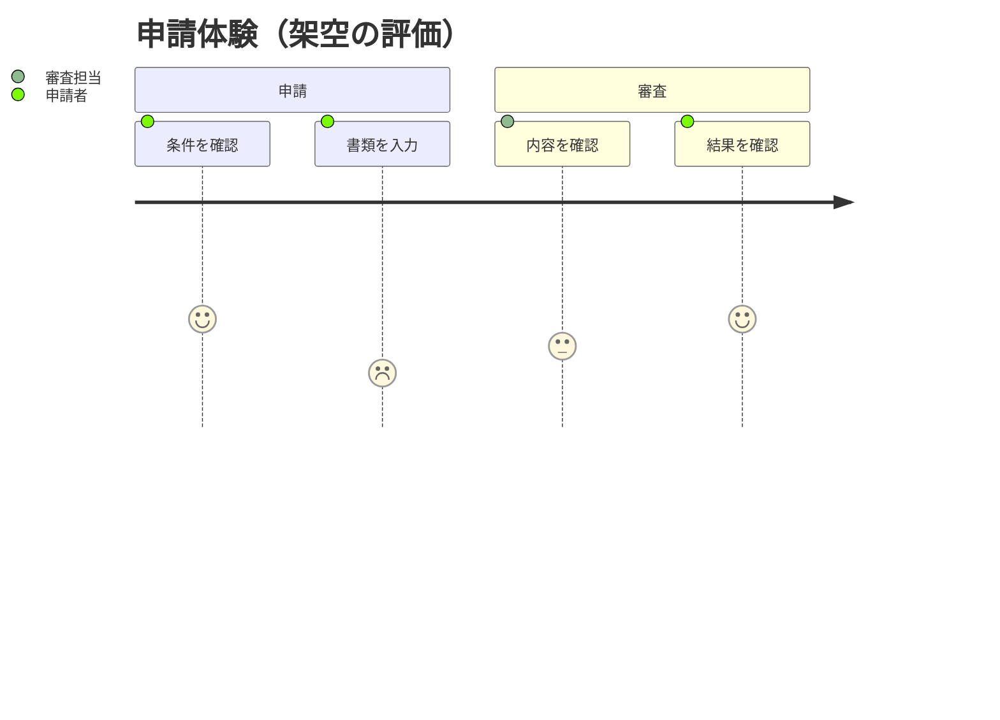

# 利用体験と困りごと

架空の申請体験の例。行動と関係者を並べ、どの段階で困るかを示す。
評価は1〜5で、この例では1を悪い体験、5を良い体験とする。実際の評価は調査結果や明示された仮説から取り、現状と改善案を分ける。

評価がない場合は数値を捏造せず、行動と困りごとの表にする。API の呼び出し順や条件分岐には別の図を使う。

## 構文の確認先

[User Journey の公式資料](https://mermaid.js.org/syntax/userJourney.html)
