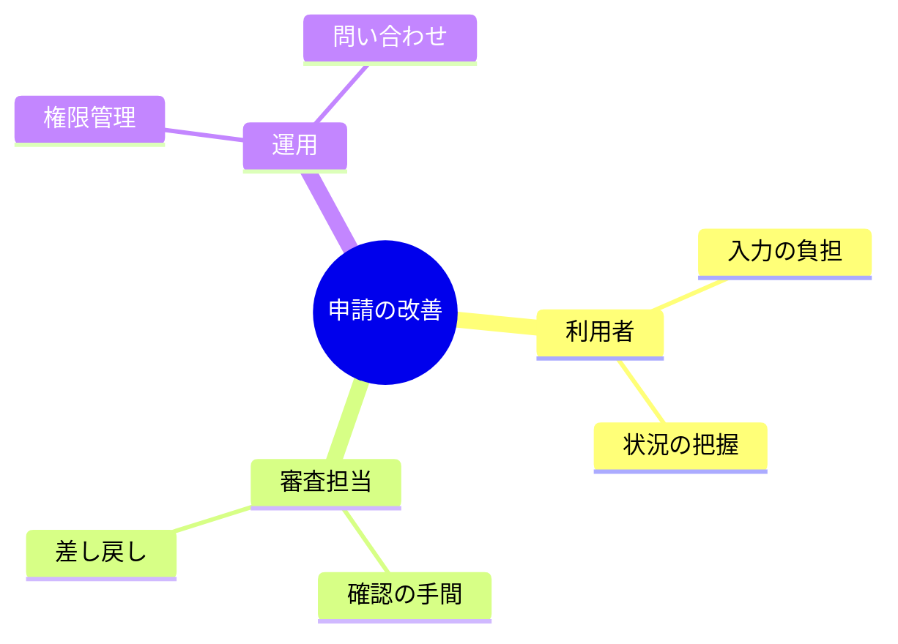

# 論点を分類する

架空の要求整理の例。中心テーマから関心を分類するために使い、処理順序や依存関係は表さない。
インデントで親子関係を示す。同じ階層では分類の粒度を揃える。

分類しただけで要求が確定したと扱わない。優先度や採否は本文や要求一覧で管理する。

## 構文の確認先

[Mindmap の公式資料](https://mermaid.js.org/syntax/mindmap.html)
