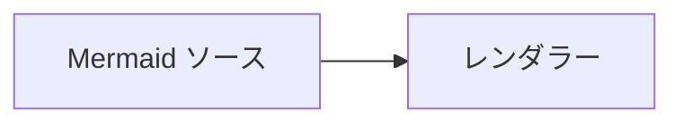

# ノードから関連資料を開く

`click` が許可される掲載先で、ノードから公式資料を開く例。
リンクの可否は掲載先で確認する。設定の扱いは [動的表現の選択と検証](../references/dynamic.md) に従う。

図の外にも [Mermaid の使い方](https://mermaid.js.org/config/usage) へのリンクを置き、画像出力やクリックできない掲載先からも参照できるようにする。
未対応なら `click` の行を除く。コールバックで処理する場合は、利用先のページ側で関数とイベントを設定する。
