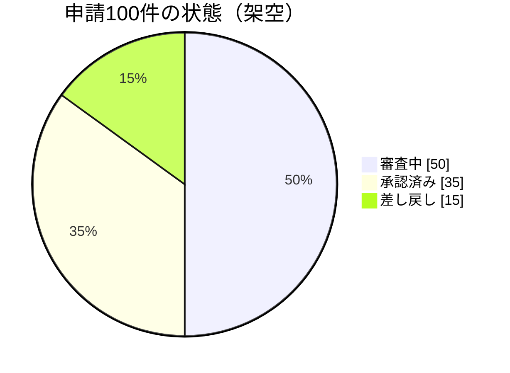

# 全体に対する内訳

架空の申請100件の内訳。分類が重複せず、全体を構成するときに使う。僅かな差を比較したい場合は棒グラフを選ぶ。

母数・集計時点・単位を添え、値の合計と全体を照合する。`showData` は入力値の表示なので、件数と割合を混同しない。
重複回答や負の値を含むデータには使わない。細分化しすぎた内訳は、根拠を示して集約するか表にする。

## 構文の確認先

[Pie Chart の公式資料](https://mermaid.js.org/syntax/pie.html)
