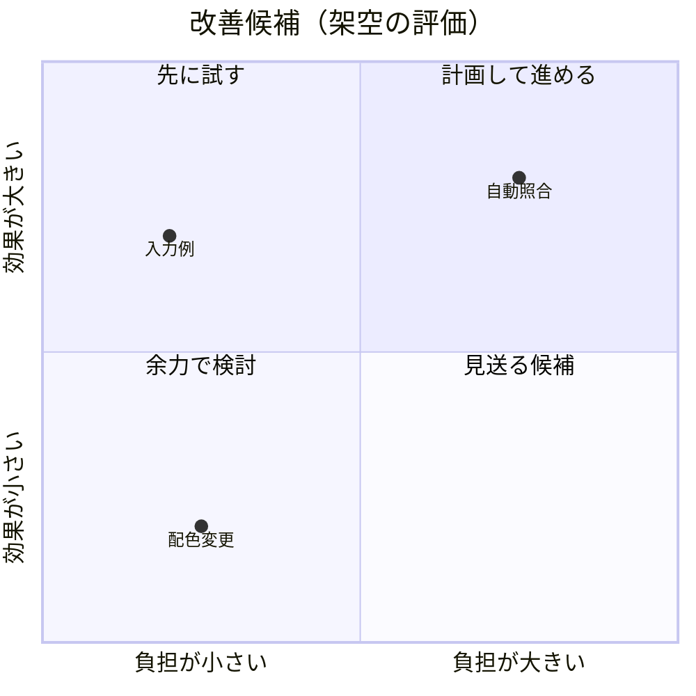

# 二つの軸で比較する

架空の改善候補の例。横軸を実装負担、縦軸を期待効果とし、相対評価を0〜1で置く。
軸の向きと評価根拠を説明し、測定していない評価を実測値に見せない。

象限だけで採否を確定しない。制約・リスク・評価の不確かさも本文へ残す。

## 構文の確認先

[Quadrant Chart の公式資料](https://mermaid.js.org/syntax/quadrantChart.html)
