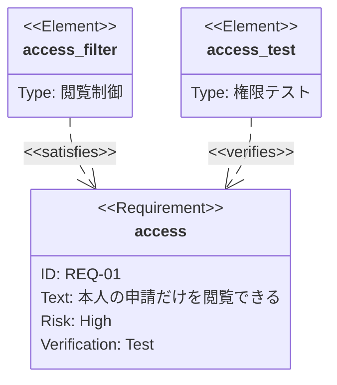

# 要求と実現・検証の対応

架空の閲覧権限の例。要求がどの設計要素で実現され、何で検証されるかを示す。
`satisfies` は実現要素から要求へ、`verifies` は検証要素から要求へ向ける。線があること自体をテスト合格の根拠にしない。

要求IDは元資料と一致させる。リスクや検証方法が未決なら勝手に確定せず、先に表などで未決事項を整理する。

## 構文の確認先

[Requirement diagram の公式資料](https://mermaid.js.org/syntax/requirementDiagram.html)
