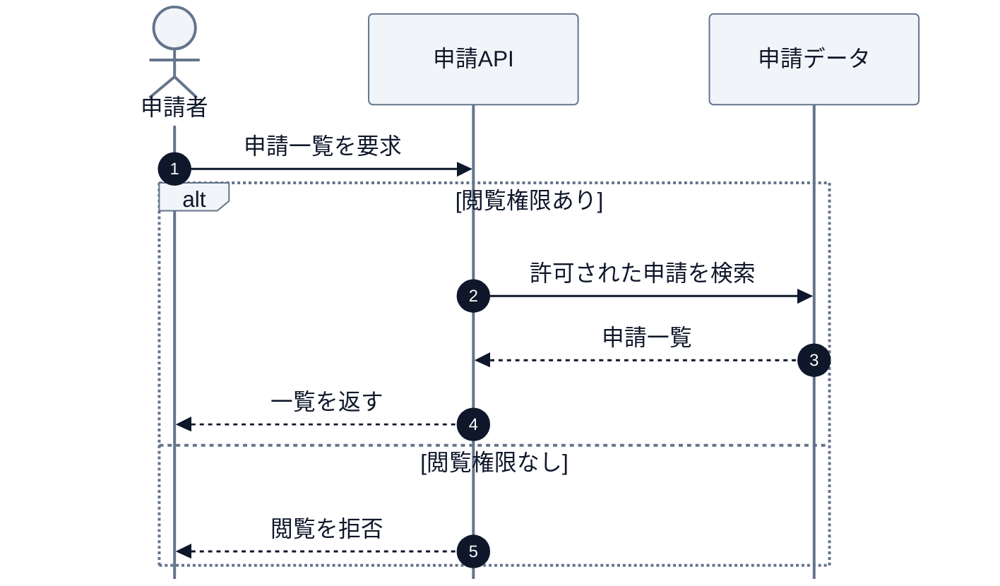

# 呼び出し順と失敗

架空の申請機能の例。実際の図では入力資料にある要素・条件へ置き換える。

参加者を固定し、メッセージには動作を書く。`alt` は条件ごとの代替経路、`opt` は条件付きの処理、`loop` は繰り返しに使う。
失敗分岐は設計にあるものを描き、エラーコードや再試行を推測で追加しない。

参加者は上部だけに置き、番号とメッセージ間の余白で読み順を示す。長い応答待ちや途中から読む図では、下部の参加者も表示する。

## 構文の確認先

対応バージョンで使える構文は [Sequence diagram の公式資料](https://mermaid.js.org/syntax/sequenceDiagram.html) で確認する。
