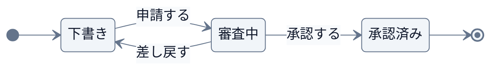

# 状態の変化

架空の申請機能の例。実際の図では入力資料にある要素・条件へ置き換える。

ノードは状態、矢印は変化の契機にする。複数主体の操作手順と混在させない。
開始・終了は対象のライフサイクルに合わせ、戻りや再申請が未決なら注記する。

主経路を左から右に揃え、差し戻しを戻り線として描く。状態名や線の色で承認・否認の意味を重複して強調しない。

## 構文の確認先

対応バージョンで使える構文は [State diagram の公式資料](https://mermaid.js.org/syntax/stateDiagram.html) で確認する。
