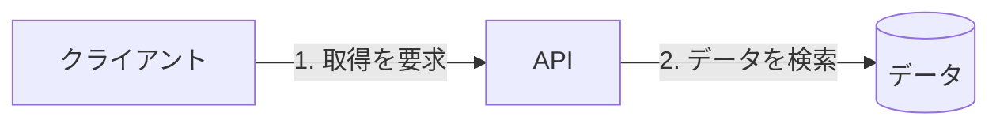

# 順番の再生

Mermaid 12.3以降で、例示した取得処理の順番を再生する。実際のシステムの状態や実行時間を表すものではない。
番号はラベルにも残し、静止状態でも順番を読めるようにする。

これは取得要求から検索までの例であり、応答や失敗時の経路は含まない。
再生は繰り返される。同じ `step` のエッジは同時に動くため、逐次処理と並行処理を元資料に合わせる。
未対応の掲載先には次の静止版を使う。

