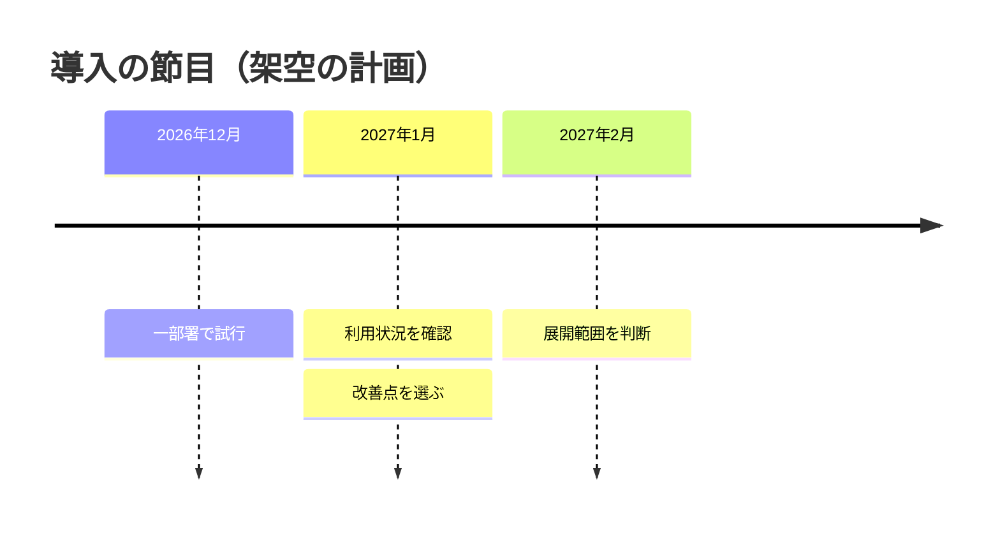

# 出来事の順序

架空の導入計画の例。節目や経緯を追わせたい場合に使う。期間や依存を管理する場合は gantt にする。

時期はソースの順に並べる。図上の間隔を正確な経過時間として読ませない。
計画・実績をタイトルや本文で区別し、未定の日付を補わない。

## 構文の確認先

[Timeline の公式資料](https://mermaid.js.org/syntax/timeline.html)
