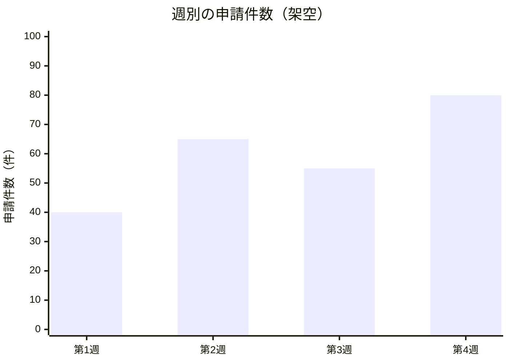

# 数量の比較と推移

架空の週別申請件数の例。カテゴリ間の量は棒、時間に沿った推移は折れ線を起点にする。
対象期間・単位・尺度を揃え、カテゴリと値の数・順序を一致させる。

数値は元資料から取り、欠測をゼロとして扱わない。棒グラフは原則ゼロ基準にし、軸の省略で差を誇張しない。
誤差範囲や複雑な統計表現が必要なら、それを表現できる作図ツールを選ぶ。

## 構文の確認先

[XY Chart の公式資料](https://mermaid.js.org/syntax/xyChart.html)
